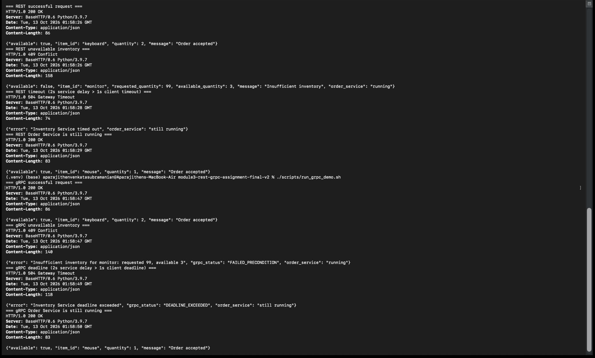

# Module 3: REST and gRPC Service Contracts

## What I built

For this assignment, I used Python to implement the same Order-to-Inventory workflow in two different ways. The Order Service receives an `item_id` and a `quantity`, then asks the Inventory Service whether that amount is available.

The first version uses REST, JSON, and an HTTP timeout. The second version uses gRPC, a Protocol Buffers contract, and a gRPC deadline. I also added a controllable delay to the Inventory Service so that both failure cases can be reproduced.

## Project structure

```text
.
├── grpc_contract/
│   ├── inventory.proto
│   ├── inventory_pb2.py
│   └── inventory_pb2_grpc.py
├── rest/
│   ├── inventory_service.py
│   └── order_service.py
├── grpc_version/
│   ├── inventory_service.py
│   └── order_service.py
├── scripts/
│   ├── run_rest_demo.sh
│   └── run_grpc_demo.sh
├── evidence/
│   └── demo-output.png
├── requirements.txt
└── README.md
```

## Setup

I tested this with Python 3.9+.

```bash
python3 -m venv .venv
source .venv/bin/activate
python -m pip install -r requirements.txt
```

Before running the gRPC demo, make sure the virtual environment is active. The terminal prompt should show `(.venv)`.

Verify that gRPC is installed:

```bash
python -c "import grpc; print('gRPC is installed')"
```

If this reports `No module named 'grpc'`, run the following while the virtual environment is active:

```bash
python -m pip install -r requirements.txt
```

The generated gRPC files are already included in the repository. If the `.proto` file is changed, they can be regenerated with:

```bash
python -m grpc_tools.protoc \
  -I grpc_contract \
  --python_out=grpc_contract \
  --grpc_python_out=grpc_contract \
  grpc_contract/inventory.proto
```

The sample inventory is:

| Item ID | Available quantity |
|---|---:|
| `keyboard` | 10 |
| `mouse` | 25 |
| `monitor` | 3 |

## REST version

The REST Inventory Service runs on port `5001`. The REST Order Service runs on port `5000`. When the Order Service calls the Inventory Service, it uses a one-second timeout.

### Start the services

Open two terminal windows and activate the virtual environment in both.

Terminal 1:

```bash
python rest/inventory_service.py
```

Terminal 2:

```bash
python rest/order_service.py
```

### Successful REST request

```bash
curl -i -X POST http://localhost:5000/orders \
  -H 'Content-Type: application/json' \
  -d '{"item_id":"keyboard","quantity":2}'
```

Example response:

```text
HTTP/1.0 200 OK
Content-Type: application/json

{"available": true, "item_id": "keyboard", "quantity": 2, "message": "Order accepted"}
```

### Inventory-not-available request

```bash
curl -i -X POST http://localhost:5000/orders \
  -H 'Content-Type: application/json' \
  -d '{"item_id":"monitor","quantity":99}'
```

This returns `409 Conflict` because only three monitors are available. The Order Service remains running when the Inventory Service rejects the request.

### REST timeout test

Stop the normal Inventory Service with `Ctrl+C`. Start it again with a two-second delay:

```bash
python rest/inventory_service.py --delay 2
```

The Order Service still has a one-second timeout. Send the following request from another terminal:

```bash
curl -i -X POST http://localhost:5000/orders \
  -H 'Content-Type: application/json' \
  -d '{"item_id":"keyboard","quantity":2}'
```

Expected response:

```text
HTTP/1.0 504 Gateway Timeout
Content-Type: application/json

{"error": "Inventory Service timed out", "order_service": "still running"}
```

This shows that the Order Service handles the slow Inventory Service instead of waiting indefinitely or terminating.

To prove that the Order Service is still running, stop the delayed Inventory Service, start the normal Inventory Service in the background, and send another request without restarting the Order Service:

```bash
python rest/inventory_service.py > /tmp/rest_inventory.log 2>&1 &

curl -i -X POST http://localhost:5000/orders \
  -H 'Content-Type: application/json' \
  -d '{"item_id":"mouse","quantity":1}'
```

This request should return `200 OK`.

## gRPC version

The gRPC Inventory Service listens on `localhost:50051`. The gRPC-backed Order Service exposes an HTTP adapter on port `5002` so that the behavior can be tested easily with `curl`.

The communication from the Order Service to the Inventory Service uses gRPC, not REST. The Order Service gives the gRPC call a one-second deadline.

### Contract

The contract is defined in [`grpc_contract/inventory.proto`](grpc_contract/inventory.proto):

```proto
service InventoryService {
  rpc CheckInventory(CheckInventoryRequest)
      returns (CheckInventoryResponse);
}
```

### Start the services

Open two terminal windows and activate the virtual environment in both.

Terminal 1:

```bash
PYTHONPATH=. python grpc_version/inventory_service.py
```

Terminal 2:

```bash
PYTHONPATH=. python grpc_version/order_service.py
```

The gRPC Order Service can be tested through its HTTP adapter at:

```text
http://localhost:5002
```

### Successful gRPC request

```bash
curl -i -X POST http://localhost:5002/orders \
  -H 'Content-Type: application/json' \
  -d '{"item_id":"keyboard","quantity":2}'
```

Example response:

```text
HTTP/1.0 200 OK
Content-Type: application/json

{"available": true, "item_id": "keyboard", "quantity": 2, "message": "Order accepted"}
```

Internally, the Order Service converts the request into a protobuf `CheckInventoryRequest` and calls `CheckInventory` using the generated gRPC stub.

### Unavailable-item error

```bash
curl -i -X POST http://localhost:5002/orders \
  -H 'Content-Type: application/json' \
  -d '{"item_id":"monitor","quantity":99}'
```

The Inventory Service returns the gRPC status `FAILED_PRECONDITION`. The HTTP adapter displays the result as `409 Conflict` so that it can be tested easily with `curl`.

### gRPC deadline test

Stop the normal gRPC Inventory Service and start it with a two-second delay:

```bash
PYTHONPATH=. python grpc_version/inventory_service.py --delay 2
```

Call the Order Service again:

```bash
curl -i -X POST http://localhost:5002/orders \
  -H 'Content-Type: application/json' \
  -d '{"item_id":"keyboard","quantity":2}'
```

Expected response:

```text
HTTP/1.0 504 Gateway Timeout
Content-Type: application/json

{"error": "Inventory Service deadline exceeded", "grpc_status": "DEADLINE_EXCEEDED", "order_service": "still running"}
```

The Order Service catches the gRPC error instead of terminating.

To verify that the gRPC Order Service remains running, stop the delayed Inventory Service, start the normal Inventory Service in the background, and send another request without restarting the Order Service:

```bash
PYTHONPATH=. python grpc_version/inventory_service.py > /tmp/grpc_inventory.log 2>&1 &

curl -i -X POST http://localhost:5002/orders \
  -H 'Content-Type: application/json' \
  -d '{"item_id":"mouse","quantity":1}'
```

This request should return `200 OK`.

## Automated demonstrations

The demonstration scripts run the successful request, the unavailable-inventory request, the slow-service test, and a request after each failure:

```bash
chmod +x scripts/*.sh
./scripts/run_rest_demo.sh
./scripts/run_grpc_demo.sh
```

The scripts use `curl -sS`, so connection and startup errors are displayed instead of being hidden. They also wait for the Order Service to start before sending requests. Temporary logs are written to:

```text
/tmp/module3_rest_*.log
/tmp/module3_grpc_*.log
```

## Evidence

The screenshot below shows:

- A successful REST request
- REST unavailable inventory with `409 Conflict`
- REST timeout with `504 Gateway Timeout`
- A successful REST request after the timeout
- A successful gRPC request
- gRPC unavailable inventory with `FAILED_PRECONDITION`
- gRPC deadline exceeded with `DEADLINE_EXCEEDED`
- A successful gRPC request after the deadline failure

The successful requests after the failures demonstrate that both Order Services remained running.



## REST and gRPC comparison

REST was easier to start with because I could send JSON directly with `curl` and inspect the HTTP response. gRPC required an additional `.proto` file and generated Python code, but it provided typed request and response messages and a clear service contract. The two implementations also report failures differently: REST uses HTTP statuses such as `409` and `504`, while gRPC uses statuses such as `FAILED_PRECONDITION` and `DEADLINE_EXCEEDED`. In both versions, the Order Service stays alive because it uses an explicit timeout or deadline and handles the error. Based on this exercise, REST feels more convenient for a public or browser-facing API, while gRPC is a strong fit for typed internal service-to-service communication.